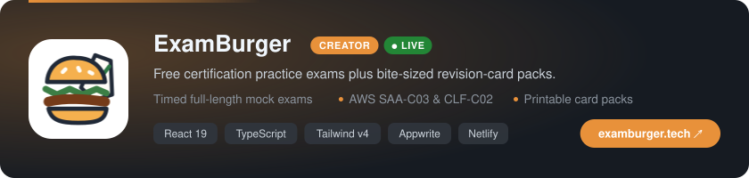
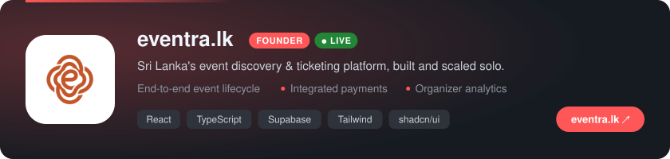
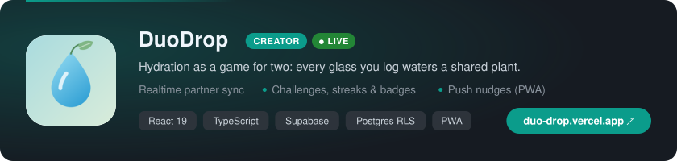

<!-- ============================== HEADER ============================== -->

  

 <!-- DEVTO-FOLLOWERS:START --><!-- DEVTO-FOLLOWERS:END -->

<!-- ============================== ABOUT ============================== -->

##  About Me

I turn complex problems into **simple, fast, accessible products**, and I take them all the way from idea to production. Enterprise systems by day, my own products by night.

- 🏆 **Founder & sole developer of [eventra.lk](https://eventra.lk)**
- 🚀 Building **[ExamBurger](https://examburger.tech)** and **[DuoDrop](https://duo-drop.vercel.app)**
- ☁️ **AWS Certified**: Solutions Architect & AI Practitioner
- 🎥 Teaching on [YouTube](https://www.youtube.com/channel/UCLY1amfukR7T-bbYYRcSyTg) & writing on [dev.to](https://dev.to/gimnathperera)
- 💬 Ask me about **React, Node.js, system design, scaling**
- ⚡ Fun fact: I love pizza 🍕

<!-- ============================== PRODUCTS ============================== -->

## 🚀 Products I've Built

  

  

  

<!-- ============================== OPEN SOURCE ============================== -->

## 🧩 Top Open Source

  🔒 <b>My best work lives in private repos</b> (eventra.lk, ExamBurger, DuoDrop and client platforms). These are my most-starred public ones.

  
  
  
  
  
  

  

<!-- ============================== TECH STACK ============================== -->

## 🛠️ Tech Stack

  

  
  
  
  
  
  
   
  
  
  
  
  

<!-- ============================== CERTIFICATIONS ============================== -->

## 🏆 Certifications

  
  &nbsp;&nbsp;&nbsp;&nbsp;&nbsp;&nbsp;
  

<!-- ============================== YOUTUBE ============================== -->

## 📺 Featured on YouTube

  
  
  

  

<!-- ============================== GITHUB STATS ============================== -->

## 📊 GitHub Stats

  
  

  

  

  

<!-- ============================== FOOTER ============================== -->

### Let's connect and build something amazing together! 🚀

